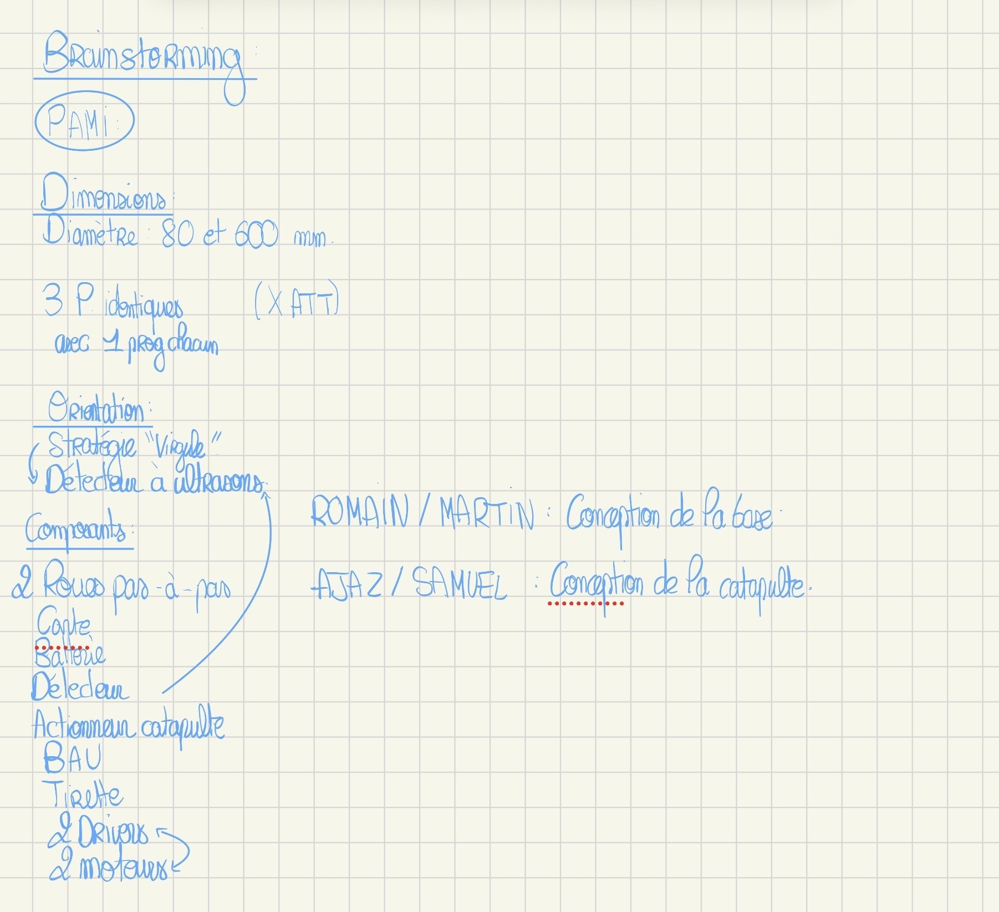

# brainstorm results :

Brainstorming : On a redéfini ce qu’on avait à faire en priorité, on s’est donc dispatchés en 2 groupes communicants pour concevoir d’une part la base du PAMI et d’autre part une catapulte (ou un autre système pour effectuer l’action d’envoyer la balle).

# catapulte pami
- fichier onshape sur espace perso
idées retenues :
- 2(?) roues a la fin d'un tube pour propulser la balle en guise d'arbalète
- une catapulte maintenue par un elastique et un servomoteur 
- canon maintenu par un bras

# commencement du commencement du canon sur onshape