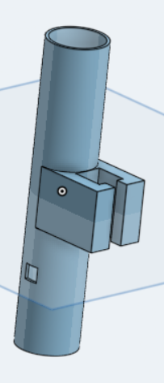
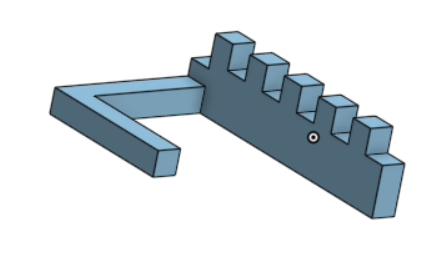
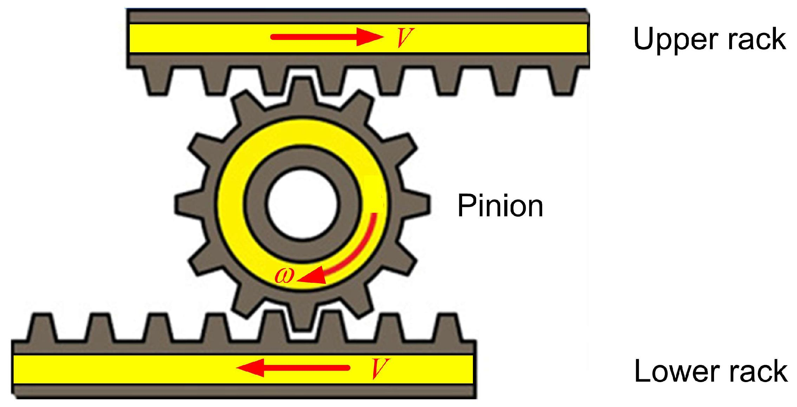
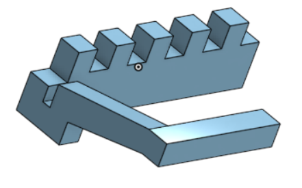

# Pami onshape :
- fait une esquisse de la catapulte +  système pour l'armorcer / desamorcer

idée d'ensemble :

ne pas oublier de faire une base rotative par un servomoteur ppour pouvoir orienter le canon.

pas oublier aussi de re-hausser le bras de la chaine pour que le haut et le bas puissent bloquer le ressort au même endroit dans le canon

verifier les dimensions pour le prochaine seance.

pas oublier de laisser savoir qu'il faudra des fentes dans la base du pami pour que les bras puissent se deplacer librement.

