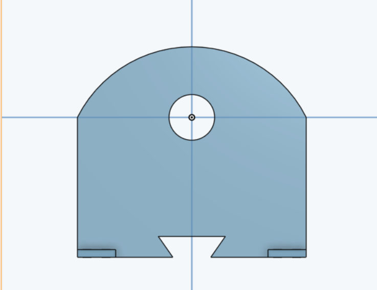
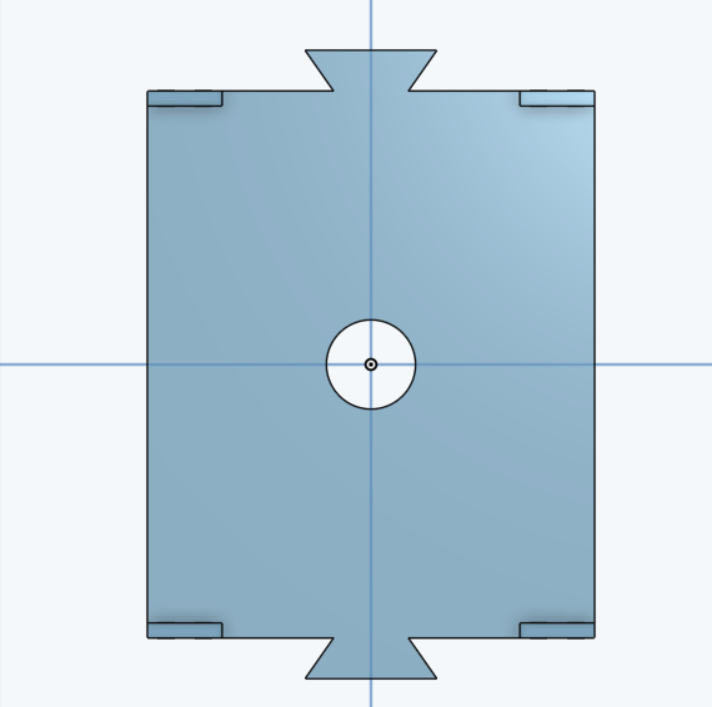
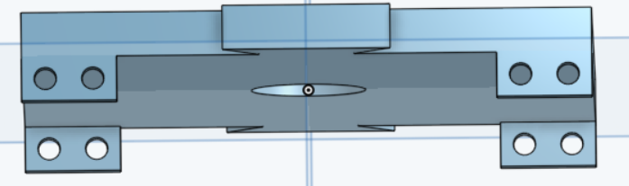
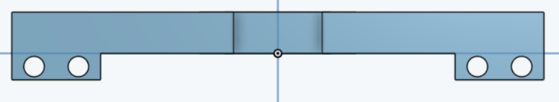

# Conception 3D 

conception 3d de la base pour les ventouses des pompes en 3 pieces : 

Celle ci à imprimer en deux fois

piece du milieu 

Les pieces seront relier entre elles avec des visses et aussi clipser comme des pieces de puzzle. 

## A faire : 

- Trouver une idée pour relier la base au reste de l'actionneur
- Realiser une piece pour relier les pompes aux ventouses 
- Diminuer la largeur des pieces 
- Faire un assemblage des pieces sur oneshape