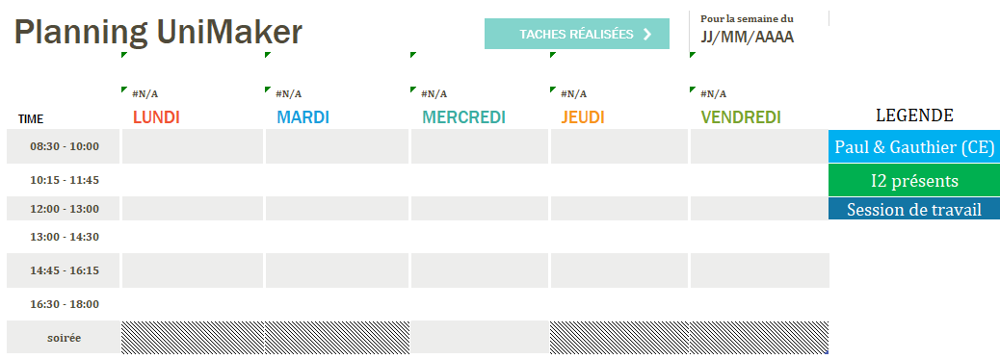
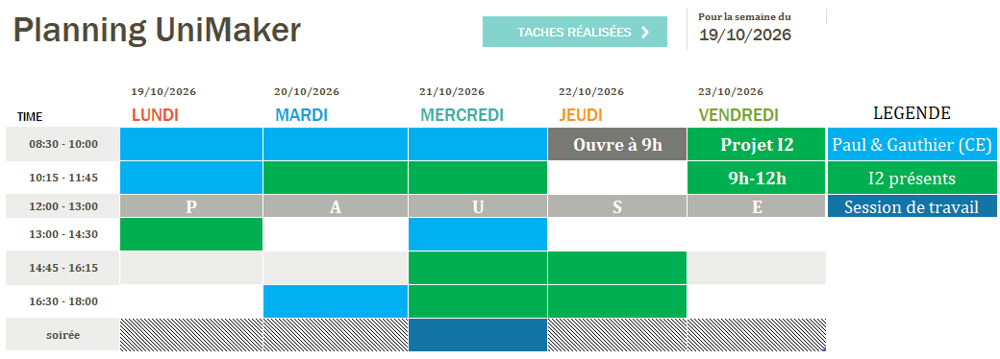

# 2026-10-20 - Création d'un template de planning

**Type de séance :** temps libre · **Durée :** <code style="color: blue;">1h30</code>

## Réalisé durant la scéance :

### Création d'un template de planning

En assistance avec la refonte du serveur Discord et dans un soucis de transparence et de communication, j'ai crée un tableau Exel en planning. Le but sera de le remplir toute les semaines afin de communiquer les périodes d'ouverture où des membres actifs sont présents pour accueillir des étudiants au robotlab.

#### Template

#### Exemple de planning remplis

Ces plannings seront potentiellement amélioré au fil du temps et selon les besoins se faisants sentir.

## A faire lors de la prochaine scéance :

| Type de tâche | Description | Priorité |
|---------------|-------------|----------|
| programmation | Commencer à programmer le PAMI 2026 | 1 |
| Conception | Brainstorm à propos du Graal  | 2 |
| Rangement | Conception des slots pour les outils de la servante | 3 |