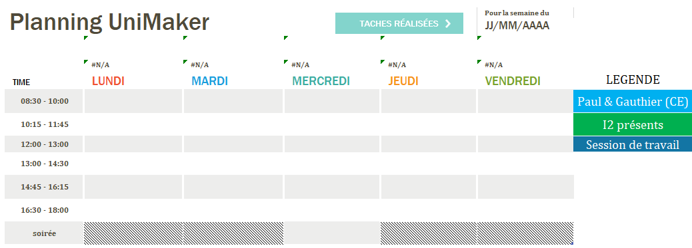
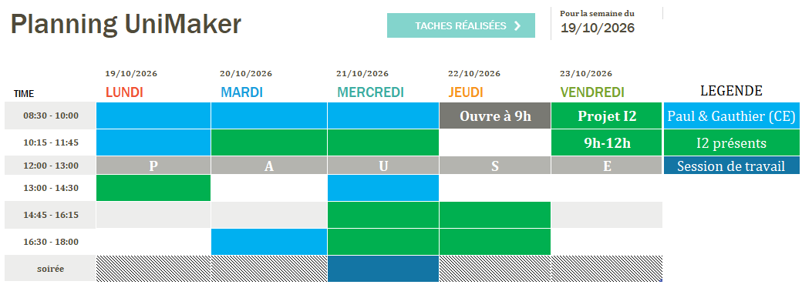

# 2026-10-20 - Création d'un template de planning
{: .no_toc }
**Type de séance :** temps libre · **Durée :** <code style="color: blue;">1h30</code>

## Table des matières
{: .no_toc .text-delta }

* TOC
{:toc}

## Réalisé durant la séance :

### Création d'un template de planning

En assistance avec la refonte du serveur Discord et dans un souci de transparence et de communication, j'ai créé un tableau Excel en planning. Le but sera de le remplir toutes les semaines afin de communiquer les périodes d'ouverture où des membres actifs sont présents pour accueillir des étudiants au robotlab.

#### Template

#### Exemple de planning rempli

Ces plannings seront potentiellement améliorés au fil du temps et selon les besoins se faisant sentir.

## À faire lors de la prochaine séance :

| Type de tâche | Description | Priorité |
|---------------|-------------|----------|
| programmation | Commencer à programmer le PAMI 2026 | 1 |
| Conception | Brainstorm à propos du Graal  | 2 |
| Rangement | Conception des slots pour les outils de la servante | 3 |