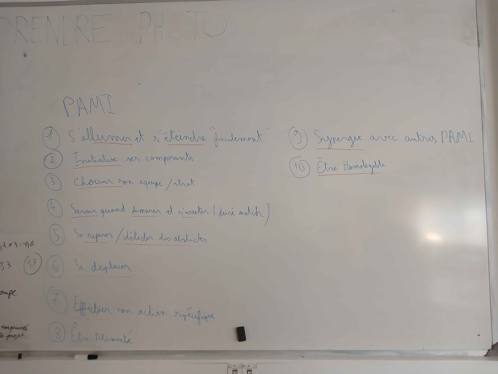
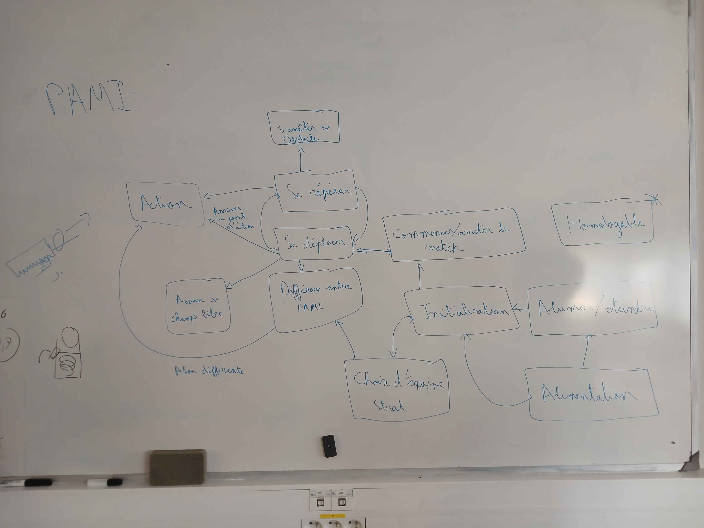

# Gestion de projet - tâches des PAMI
{: .no_toc }
**Type de séance :** Planifiée - Gestion de projet · **Durée :** <code style="color: blue;">1 h 30</code>

## Table des matières
{: .no_toc .text-delta }

* TOC
{:toc}

## Réalisé durant la séance :

Dans le cadre du cours de gestion de projet, nous avons écrit une histoire sur les PAMI afin d'en extraire les étapes importantes. Bien que la forme de l'histoire soit enfantine et peu sérieuse, les étapes techniques présentes le sont.

### L'histoire des PAMI

*Il était une fois, un PAMI appelé Pierre-Armand-Michel-Ingrind et son propriétaire
George. George est stupide, stressé et n’a jamais touché Pierre-Armand-Michel-Ingrind
avant d’arriver à la coupe ce qui nous fait nous demander ce qu’il fout là.
George se retrouve donc perdu devant la table de match avec Pierre-Armand-Michel-Ingrind et doit maintenant l’installer avec ses amis Patrick-Anita-Maurice-Isolda, Paul-Albert-Michael-Ilbert et Patricia-Albertine-Moustafa-Ivone.
George sort donc les PAMI un par un sur la table. Leur prénom est visible sur des
badges prévus à cet effet (avec un chiffre de 1 à 4). Il peut donc les placer dans leur
ordre numérique à l’aide des repères qui lui ont été fournis.
Une fois Pierre-Armand-Michel-Ingrind et sa bande installés dans leur position
respective. George les allume un par un (sachant qu’ils possèdent chacun leur
propre système d’alimentation) et peuvent faire signifier à George qui est stupide mais a
des yeux qu'ils sont bien allumés.
George peut ensuite les initialiser (avant ou pendant le posage de la tirette) ce qui
entraine une réaction favorable ou défavorable de la part des PAMI pour signifier s'ils
ont bien été initialisés ou si au contraire ils ont subi une erreur. Dans le cas de l’erreur,
s’il y a le temps, George peut tenter un reboot. Dans le cas contraire, il retire les
PAMI défaillants de la table et les remet à l’EPAD (l’Entrepôt pour PAMI Dégradé). Si
ça n’est pas déjà fait, George pose la tirette sur la tête des PAMI qui montreront
alors qu’ils sont prêts à en découdre (avec une LED même si on ne juge pas sur le
physique).
Au top du début de match, George peut alors tirer sur la tirette (et non pousser tu es
stupide George). Et Les PAMI attendront donc patiemment le temps approprié avant de
s’élancer dans le feu de l’action et réaliser leur mission avant de s’arrêter à l’issue du
match, qu’ils aient terminé leur action ou non.*

En groupe, nous avons établi une liste des actions que le PAMI doit réaliser lors de sa phase de préparation, pendant le match et à la fin de celui-ci *(voir photo ci-dessous)* :

À partir de cette liste, nous avons ensuite réalisé un schéma simulant toutes les étapes auxquelles le PAMI sera confronté *(voir photo ci-dessous)* :

## Conclusion de la séance :

Nous avons pu avoir une meilleure idée de ce qui est à faire en termes de tâches concernant les PAMI.