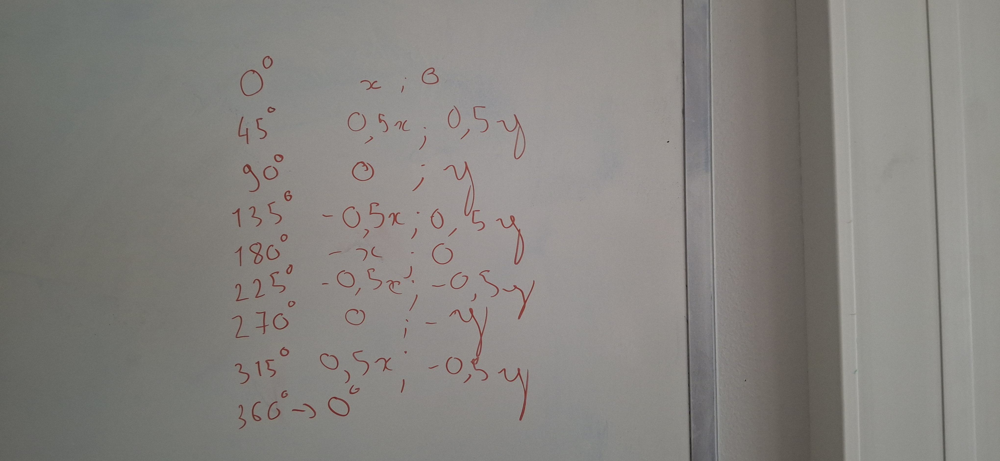

# Détection d'obstacles, déplacement absolu et nouvelles roues
{: .no_toc }
**Type de séance :** Session de travail · **Durée :** <code style="color: blue;">4h30</code>

## Table des matières
{: .no_toc .text-delta }

* TOC
{:toc}

## Réalisé durant la séance :

### Mise en place de la détection d'obstacle

J'ai créé la bibliothèque détection mais pour l'instant, rien n'a été fait pour l'instant car d'autres besoins ont été évoqués.

### Déplacement absolu

Les modules de déplacement actuels sont en relatif, c'est-à-dire se déplacer de n pas depuis son point de départ. Néanmoins, ce système montre rapidement ses limites car il exige que le chemin soit décidé à l'avance depuis le même point de départ et le même point d'arrivée. Cela induit qu'aucune déviation n'est permise et que rien ne permettra de corriger la trajectoire en cas de présence d'un obstacle.

J'ai donc commencé à réfléchir à des fonctions permettant de passer de relatif à absolu et inversement.

À ce stade, j'ai effectué un brainstorm théorique afin de déterminer les fonctions utiles à intégrer au firmware.

J'ai réfléchi principalement à l'actualisation des coordonnées en fonction de l'orientation du PAMI.

### Création et impression de nouvelles roues

Afin de changer les anciennes roues peu optimisées et qui se fixaient de travers, j'ai modélisé et imprimé des nouvelles roues. J'ai aussi refait des mesures afin de mettre les bonnes dimensions de roue et de diamètre de base pour avoir les rotations les plus précises possibles.



## Conclusion de la séance :

Cette session de travail a apporté beaucoup de nouvelles perspectives à mettre en place. Principalement le déplacement absolu et une manière de créer un système d'évitement des obstacles proche d'un pathfinding.

## À faire lors de la prochaine séance :

| Type de tâche | Description | Priorité |
|---------------|-------------|----------|
| Programmation | Mettre en place des fonctions de déplacement absolu | 1 |
| Conception | Brainstorm à propos du Graal | 2 |
| Documentation | Mettre à jour la documentation sur la programmation des PAMI (à faire quand le code absolu sera terminé) | 3 |