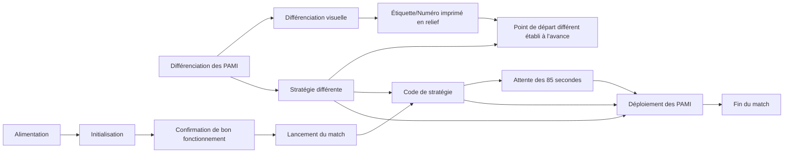

# Gestion de projet - Organisation et choix techniques pour PAMI
{: .no_toc }
**Type de séance :** Planifiée - Gestion de Projet · **Durée :** <code style="color: blue;">1h30</code>

## Table des matières
{: .no_toc .text-delta }

* TOC
{:toc}

## Réalisé durant la séance :

Dans le cadre du cours de gestion de projet, nous avons réalisé un scénario (plus sérieux que [la dernière fois](2026-11-13.md)) afin de mieux 
### Scénario technique

### Étape 1 - Préparation sur la table

On arrive avec les PAMI pour la phase de préparation, on les sort de leur **stockage** (boite, chariot...) un par un pour les **positionner** de gauche à droite selon leur **identification**.

Une fois les PAMI positionné correctement, on les **allume** (BAU) et on **les initialise**, les PAMI **renvoient un signal signifiant leur bon fonctionnement et la complétion de leur initialisation** (visuel ou sonore). Si ce n'et pas le cas, le PAMI est en **erreur** et peuvent-être rebooté si le temps le permet. Dans le cas contraire, il est retiré de la table. Si tout est bon, on positionne la **tirette** (contrainte de match) et une fois le signal donné, on retire la tirette annonçant au PAMI **le début du match**

### Étape 2 - En attente - entre 0 et 85sec

Les PAMI ne commencent qu'à la **85ème seconde du match**. Il est donc essentiel, qu'ils **attendent** cette échéance avant de démarrer leurs **actions**

### Étape 3 - En actions - après 85sec

Une fois les 85 secondes écoulées, les PAMI se **déploient** afin de réaliser leur action correspondant à leur **stratégie**. Ils doivent **se déplacer aux endroits prévues** en **évitant les obstacles** et **réaliser leur action au point défini**.

### Étape 4 - Fin du match - 100sec

Une fois l'action réalisée ou la fin du match déclaré, le PAMI **s'interrompent imédiatement**.

### Diagramme technique

## Conclusion de la séance :

