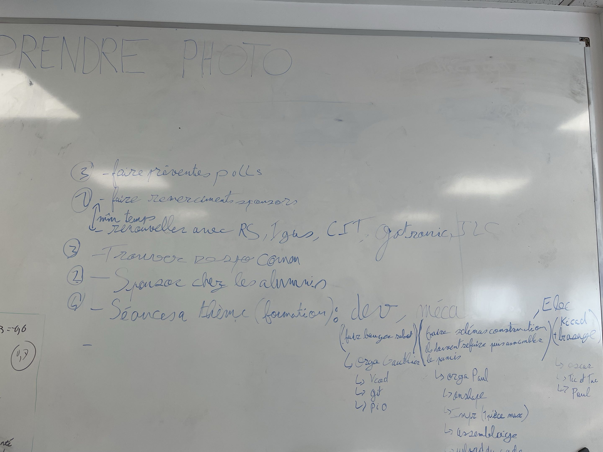

Envoie d'un mail au crédit agricole, pour les demandes de subvention.

**
Bonjour Mme Boully Frison,

Je vous contacte en tant que coprésident de l'association étudiante Unimakers Amiens.

Rattachée à UniLaSalle Amiens, UniMakers réunit 23 membres actifs autour de la conception de robots autonomes pour la Coupe de France de Robotique, mais aussi d'initiatives à fort impact social et environnemental, comme notre Repair-Space (atelier de réparation d'appareils électroniques luttant contre le gaspillage numérique) et l'organisation d'une future compétition régionale à Amiens.
Pour la saison 2026-2027, notre budget prévisionnel s'élève à 6 300 €, principalement axé sur l'achat de matériel électronique et la prise en charge des déplacements/hébergements de nos équipes. Nous sommes à la recherche de 2000 € pour compléter ce budget.

Connaissant l'engagement du Crédit Agricole Brie-Picardie auprès des jeunes et du tissu associatif local, nous souhaiterions solliciter une subvention ou un soutien via la Caisse Locale d'Amiens ou la Fondation Crédit Agricole. 

Pourriez-vous nous indiquer la démarche à suivre ainsi que les formulaires à compléter pour déposer un dossier ? 

Vous trouverez notre dossier sponsor complet en pièce jointe pour de plus amples détails sur nos actions. Nous restons à votre entière disposition pour échanger de vive voix ou convenir d'un rendez-vous. 

Bien cordialement,
Gauthier HENRIQUES
Co-président d'UniMakers Amiens
UniLaSalle Amiens — 13 Rue Jean Moulin, 80000 Amiens 
Téléphone : 06 31 25 84 79
Email : unimakers.amiens@gmail.com 
Site web : https://unimakers.fr/
**

Mise en place, de nos prochains besoin/ à faire

