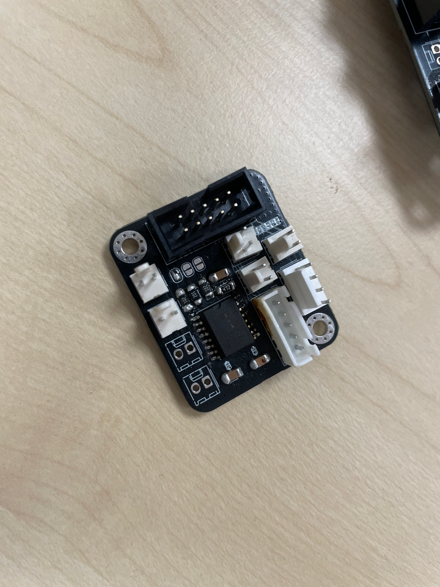

# 2026-11-04 : Électronique et réponses des sponsors

## Électronique

Soudure de la carte électronique head, pour faire rouler le robot dans la semaine.

## Réponses des sponsors

| Sponsor | Réponse | Suite à donner |
|---|---|---|
| **JLCPCB** | Reel validé, prêt pour la commande des cartes | Répondre à leurs questions, contacter Adrien Bracq |
| **CIT Dessaint** | Renouvellement accepté : 15 % de réduction, comme l'année dernière | — |
| **Crédit Agricole** | La demande de subvention est à faire en 2027 | Relancer en 2027 |

### Questions de JLCPCB

- Est-ce qu'on met leur logo sur le robot ?
- Est-ce qu'on prévoit des t-shirts ?
