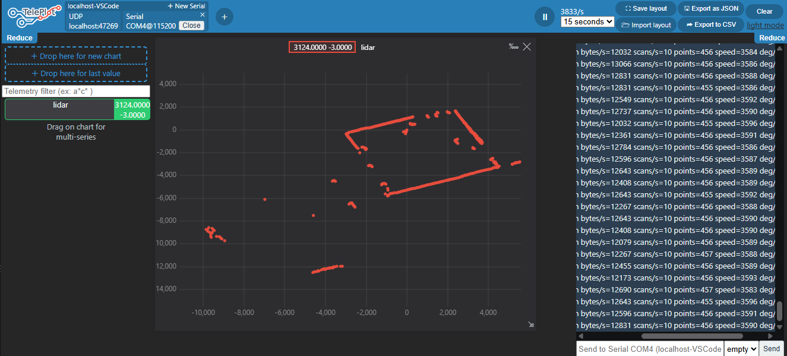

# 2026-11-24 : LiDAR LD06 fonctionnel

## Fait

Suite du [test du 20/11](2026_11_20.md) : le **LiDAR LD06 fonctionne**, les scans s'affichent bien dans [Teleplot](https://teleplot.fr/).

## Pourquoi

Au départ, le LiDAR ne scannait pas. Après plusieurs essais, je l'ai **débranché puis rebranché** pour vérifier le connecteur, et il s'est mis à scanner.

## Reste à faire

> **À vérifier :** le connecteur du LiDAR a probablement un **faux contact**. À contrôler (ou à remplacer) avant de l'intégrer sur le robot.
