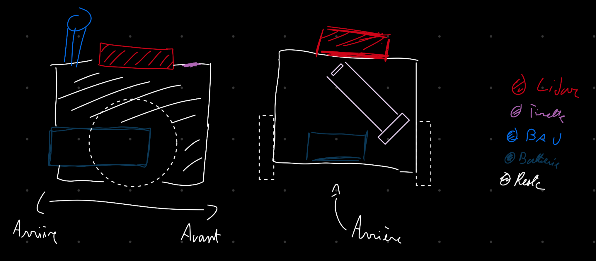

# 2026-11-20 : Esquisse du PAMI

Nous avons décidé d'intégrer un LiDAR au PAMI cette année, en complément du capteur à ultrasons. Le LiDAR sera fixé sur le PAMI avec un pilier dédié au BAU.

* **Problème éventuel :** le canon de l'actionneur pourrait obstruer le champ de vision du LiDAR.
* **Solutions possibles :** Raccourcir le Canon ou créer une zone morte du LiDAR.

Reste à établir si on peux placer le BAU au même niveau que le Lidar et ça correspond au réglement (BAU reste facilement accesible) 

