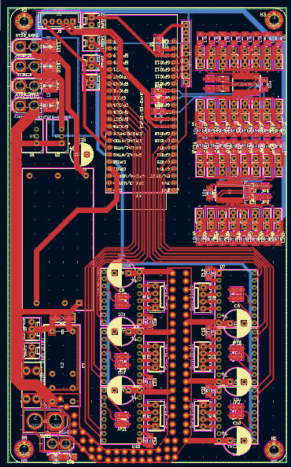

# arte élec
## erreures que j'avais faites
### j'ai utilisé un pcf au lieu d'un pca, le pcf ne fonctionne pas bien avec un servo moteur car le pcf a une latence de quelques micros secondes ce qui fait sacader le mouvement du servo et cela pourrais amener des problèmes.

### pour les pins rx tx du lidar, je les avais mis sur les pins rx tx inscrit sur la carte or ce sont des pins d'adressage mémoire, si je les avais laisser brancher dessus et cal aurais pus réecrir la mémoire flash de l'esp.

## corrections
### j'ai remplacer pcf par pca, j'ai changer les pins de rx tx et j'ai enlever u switch pour ajouter le pin oe 
### 