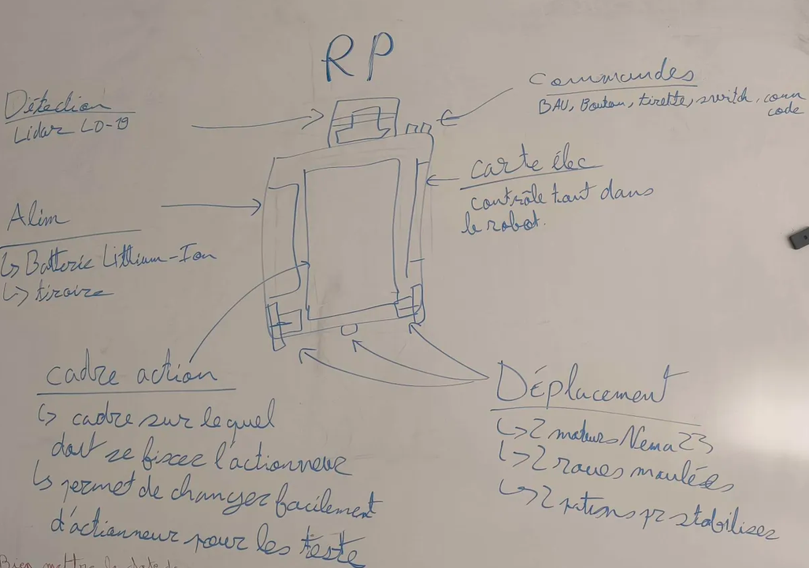

# création de résumer des fonctionalitée du robot.
### 

# recherche existant pour actionneur.

| Solution étudiée | Source | Avantages | Inconvénients | Ce qu'on retient |
|---|---|---|---|---|
| pinces a carton |  | meilleurs maintiens | quand on prend et pose le carton il n'y a auqu'un probleme mais quand on doit le tourner le carton et le poser cela bloque car il y a un un rebord en dessous qu peut fair chuter le carton surtout si il est en toure | je prend pas cette méthode |
| ... | https://vention.com/fr/industrial-palletizer?utm_adgroupid=178390434898&utm_adid=743284028061&utm_device=c&utm_source=google&utm_medium=ppc&utm_campaign=19853462813&utm_term=&hsa_acc=6710393722&hsa_cam=19853462813&hsa_grp=178390434898&hsa_ad=743284028061&hsa_src=g&hsa_tgt=dsa-2498308563483&hsa_kw=&hsa_mt=&hsa_net=adwords&hsa_ver=3&gad_source=1&gad_campaignid=19853462813&gclid=CjwKCAjwrbfWBhAeEiwAc2e6PujXoLJ0eE_-lAI04AC3sCYiuTQpsCsy4le4yvL1t64K-MeF6EnxOBoCQBYQAvD_BwE | ... | ... | Écarté : ... |