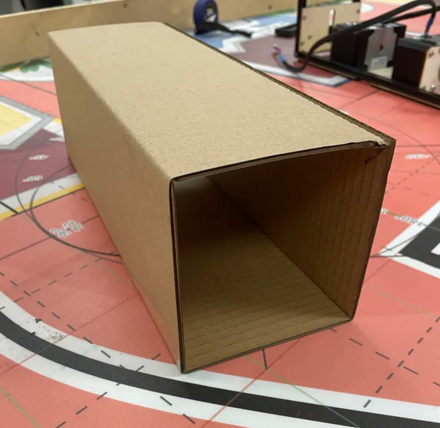

# dossier de dmve 
### J'ai créer le dossier rapport d'activité, le dossier projet pour l'année a venir et j'ai commencer la lettre de "motivation".

### il me reste a terminer la lettre et faire vérifier le tout.

# éléments de jeux
### j'ai réaliser 13 cartons de bonne dimmentions a plus ou moin 1mm de différence, mais 1mm est négligeable.

### pour faire le carton, il faut découper a la laser les patrons puis plier le coin en triangle en réalisant un antaille de l'angle a l'angle, et on termine ar faire des antailles tous les 107mm en partant du rebord totalement plat et enfin, on préplis et enfin on colle le bord triangle a deluis plat et on obtiens cela :

### 

### par la suite il faut découper des carré a la laser et les coller sur les rebords.

### il reste a ajouter les dessus et dessous de toutes les boites. et après je pourrais faire de teste de poids, de rigidité