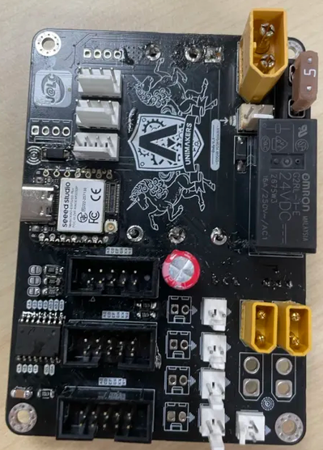

### j'ai fini le dossier de DMVE il manque plus qu'a l'envoyer

### aujourd'hui j'ai ressouder la carte électronique de l'an dernier pour que gauthier puisse avancer sur le code du robot principale et faire ces tests notament pour faire bouger le robot. 

### j'ai coller les cotés des cartons il ne restera qu'a en faire 3 dans un premier temps puis 18 autres cartons pour faire des testes avec deux robots en meme temps.

### j'ai répondu a jlcpcb c'est tout bon on vas bientot recevoire la cartes élec du robot.