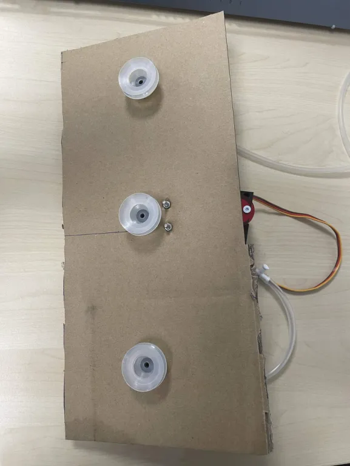
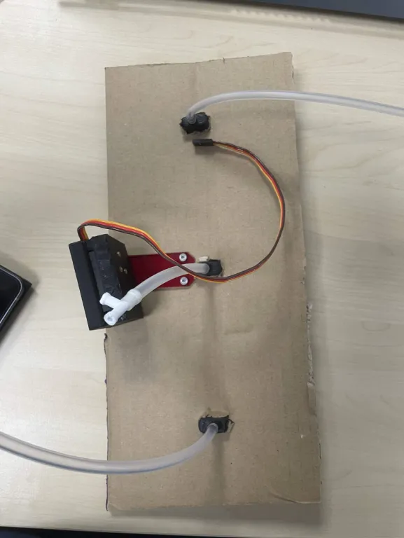

# Realisation d'un prototype de l'actionneur 

Sur une base en carton on fixe 3 ventouses de pompe espacées entre elles de 10,6cm (largeur d'un carton).
A l'arrière de la base en carton on fixe un servomoteur pour la rotation de la base - des pompes

## Avant du prototype 

## Arrière du prototype 

# Problèmes rencontrés :

Problème de puissance d'aspiration à cause d'un manque de pompe. 2 pompes utilisées au lieu de 3 donc 1 toyaux pour deux ventouses et trop long. 
Probleme lors de la rotation, les cartons percutes le sol