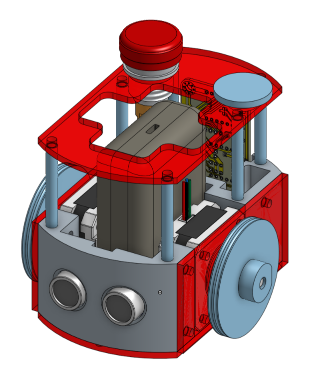

# dossier de DMVE 
### le dossier de dmve est terminé, il faut maintenant l'envoyer a madamme cocq.
### il a été validé par adrien, on a refait la présentation

# test pompe
### nous avaons avec baptiste essayer de faire fonctionner des cartes pompes sur une carte otto mais cela n'a pas fonctionné comme nous le voulions (juste un tout petit peu, elle a vibrer). la carte ne pouvais pas suffisamment alimenter la carte pompe qui devait avoir du 5v, 1A

# préparation de la scéance électronique des i1
### j'ai préparer fait entièrement un robot type pami sans actionneur de la manière la plus simple possible pour que les nouveaux puisse le refaire depuis un dessin technique 
### les I1 deverons faire les pièces sur onshape:
- une imprimer en 3d que je leurs donnerais quand ils l'auront terminé;
- deux plaques a décoper a la laser.
### esuite quand ils auront terminer la modélisation, je leurs donne les pièces et leurs but vas etre d'assembler le robot entièrement avec l'électronique et tt.
### ensuite je leurs propose de réfléchir a comment ils peuvent l'améliorer et je leurs laisse jusqu'a la semaine d'après pour le faire. 
### la semaine d'après ils doivent faire le code avec gauthier et roule ma poule !

## image du robot en cao
### 