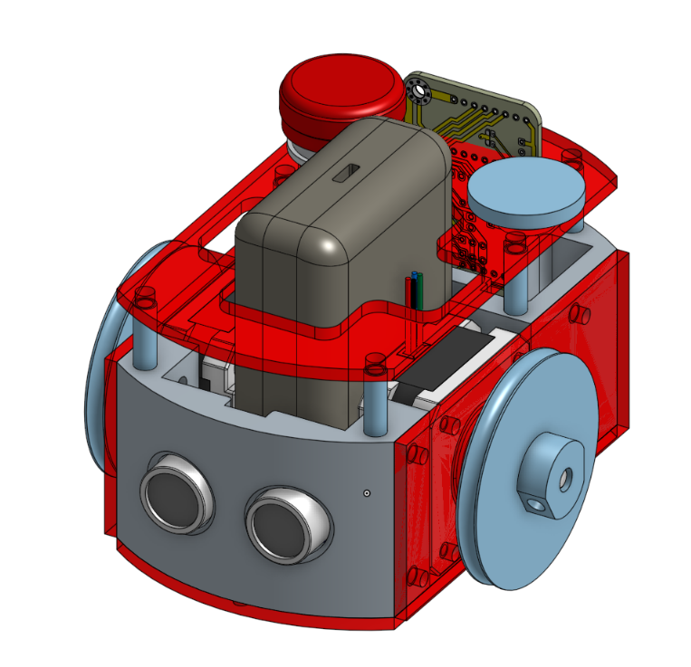

# Initiation à la mécanique des PAMIs – I1/B1

**Date :** 09-11-2026
**Auteur :** Paul Lapeyronnie
**Public :** étudiants de I1 / B1
**Thème :** conception mécanique d'un PAMI sur Onshape

---

## 1. Contexte

Dans le cadre de la préparation de la Coupe de France de robotique, l'association Unimakers Amiens souhaite rendre la robotique accessible à tous les étudiants. Les PAMIs (petits robots secondaires) sont un excellent support pour cela : ils sont simples, complets (mécanique, électronique, code) et réalisables par des débutants.

Cette journée était consacrée à la **première séance d'initiation : la mécanique**.

## 2. Objectif de la séance

Donner aux participants **l'ensemble des bases nécessaires** pour concevoir un PAMI sur **Onshape** :
- prise en main de l'interface d'Onshape ;
- création d'esquisses (sketch) et de pièces (extrusions, perçages, etc.) ;
- cotation et respect des contraintes dimensionnelles ;
- notions de conception pour l'impression 3D et la découpe.

## 3. Déroulement

### 3.1 Présentation et prise en main
- Présentation du principe d'un PAMI et du cahier des charges.
- Démonstration des fonctions de base d'Onshape.

### 3.2 Le PAMI de démonstration
J'ai préparé en amont un PAMI **volontairement non conforme** au règlement/cahier des charges. Il sert de base de travail : les participants partent d'un modèle existant, l'analysent et le reproduisent plutôt que de partir d'une page blanche.

Ce PAMI est composé de :
- **plaques découpées** (en rouge sur le modèle) : plateau supérieur et flancs ;
- **pièces imprimées en 3D** : le châssis avant (en gris) qui accueille les deux capteurs à ultrasons, et les deux roues (en bleu) ;
- **l'électronique** : un pack de batterie, une carte électronique sur le dessus, un bouton et deux capteurs à ultrasons à l'avant ;
- des entretoises pour assembler les différents étages.

[À compléter : en quoi il est non conforme (dimensions, poids, etc.), lien vers le document Onshape si pertinent]

### 3.3 Les exercices donnés aux participants
Les objectifs fixés à chacun sont les suivants :

1. **Reproduire une pièce sur Onshape**, puis **l'imprimer en 3D**.
2. **Reproduire une plaque** sur Onshape, puis **la découper**.
3. **Assembler le PAMI complet** avec l'électronique.

Cette progression permet de couvrir les trois grands procédés de fabrication utilisés à l'asso (modélisation, impression 3D, découpe) et de finir par un robot concret.

## 4. Résultats et retours

- [À compléter : avancement des participants, difficultés rencontrées, points bien compris]
- [À compléter : photos de la séance / des pièces]

## 5. Difficultés et améliorations possibles

- [À compléter : points à clarifier pour la prochaine fois, durée à ajuster, matériel manquant]

## 6. Suite

Une fois la partie mécanique maîtrisée et les PAMIs assemblés avec leur électronique, la **prochaine étape sera une initiation au code** pour les faire fonctionner.

- [ ] Suivre l'avancement des pièces imprimées et découpées
- [ ] Planifier la date de l'initiation au code
- [ ] Préparer le support de l'initiation au code

---

*Journal de bord – Unimakers Amiens*