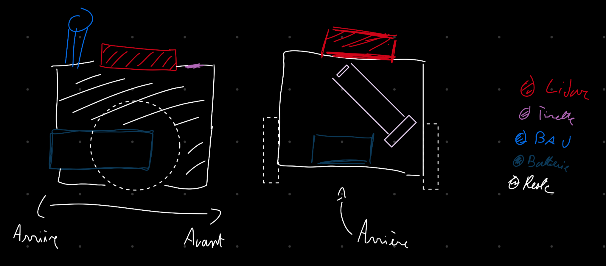

# 2026-11-20 : PAMI

**Séance :** planifiée · **Durée :** 3 h

## Fait

On a brainstormer sur la forme du PAMI ainsi que les equipement utiliser. Nous avons donc décider d'utiliser un radar poser sur notre PAMI qui sera completer par le détecteur ultrason, car les boîte coucher seront plus bas que notre lidar.

Probleme: Le PAMI ne serait peut etre pas homologuer et il faudrait donc surlelever le BAU.

## Reste à faire

Demander où mettre le BAU pour l'homogolation
Faire la carte electronique du PAMI
