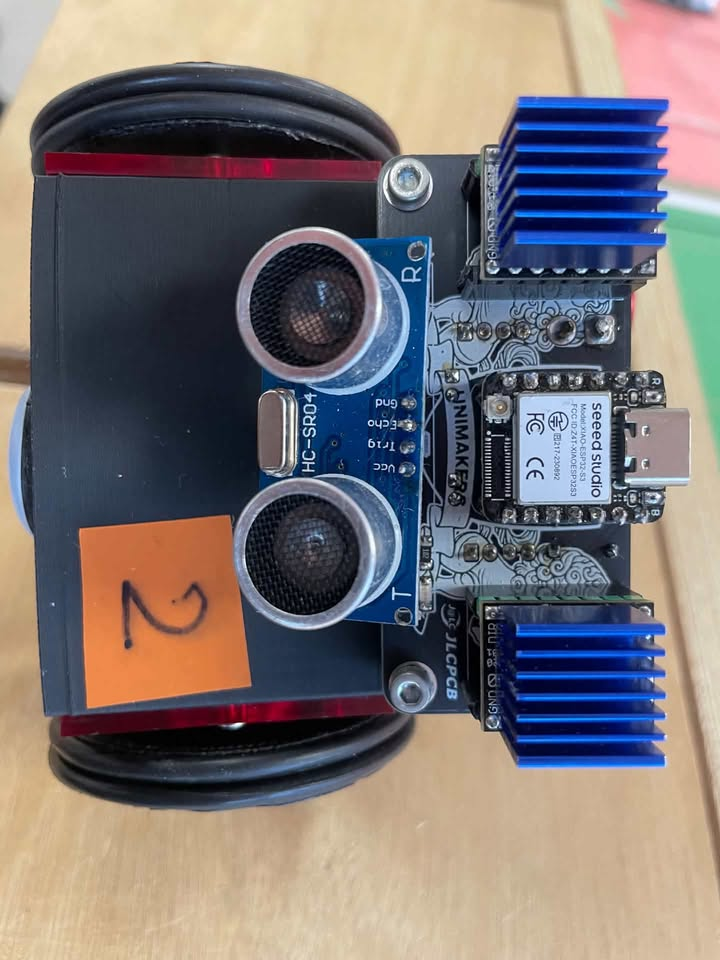

# Bilan de la semaine — Unimakers Amiens
**Semaine du 15 au 21 octobre 2026 · Eurobot / CDR 2027**

---

## Sommaire

1. Vue d'ensemble de la semaine
2. Carte électronique du robot principal (Paul, Gauthier)
3. Firmware robot principal (Gauthier)
4. Partenariat JLCPCB (Paul, Gauthier)
5. Sponsors et communication (Gauthier, Paul)
6. Bonnes pratiques Git
7. Autres avancées (hors journaux de bord)
8. Points d'attention

---

## 1. Vue d'ensemble

| Chantier | Qui | État |
|---|---|---|
| Carte électronique robot principal | Paul | **Carte finie**, prête à être commandée |
| Firmware robot principal | Gauthier | Code commenté, config à adapter au nouveau PCF |
| Partenariat JLCPCB | Paul, Gauthier | Mail d'excuse envoyé, **JLC a répondu favorablement** |
| Sponsors | Gauthier, Paul | Vidéo de remerciement en ligne, dossier sponsor corrigé et traduit en anglais |
| Firmware et doc PAMI (SIMA) | Emrick | Base du firmware créée, doc mise à jour (cf. partie 7) |

Journaux de bord de la semaine :
- Gauthier : [19/10/2026](../journal/Gauthier_Henriques/19_10_2026.md) · [20/10/2026](../journal/Gauthier_Henriques/20_10_2026.md)
- Paul : [19/10/2026](../journal/Paul_Lapeyronnie/2026-10-19.md) (et [14/10/2026](../journal/Paul_Lapeyronnie/2026-10-14.md), non couvert par le récap précédent)

---

## 2. Carte électronique du robot principal

### Paul ([journal du 14/10](../journal/Paul_Lapeyronnie/2026-10-14.md))
- Ajout d'un **PCF** pour piloter les switchs, la tirette, le bouton et le **EN des TMC2209**, afin de libérer des pins sur l'ESP32

### Gauthier ([journal du 19/10](../journal/Gauthier_Henriques/19_10_2026.md))
- **La carte est finie !**
- Prochaine étape côté code : réadapter la config pour accueillir ce nouveau PCF

---

## 3. Firmware robot principal

### Gauthier ([journal du 19/10](../journal/Gauthier_Henriques/19_10_2026.md))
- Ajout de **commentaires sur tout le code backend** pour que chaque partie soit expliquée
- D'après le dépôt (commit du 19/10) : configuration des drivers stepper revue (**6 → 4 TMC2209**, pin EN partagée), intégration du **LiDAR LD06** documentée, timer de match fiabilisé, tests breadboard (I2C, PCA, stepper, roues) mis à jour

---

## 4. Partenariat JLCPCB

### Le problème ([journal de Paul du 19/10](../journal/Paul_Lapeyronnie/2026-10-19.md), [journal de Gauthier du 19/10](../journal/Gauthier_Henriques/19_10_2026.md))
- En voulant commander les cartes, l'équipe s'est rendu compte que **l'ancien directoire n'avait pas rempli sa part du contrat** avec JLC (le mail de réponse n'avait jamais été envoyé)
- Contreparties attendues : un **reel Instagram**, **2 articles** et une **correction du site web**

### Ce qui a été fait
- Reel publié sur Instagram et site web corrigé
- **Mail d'excuse** rédigé par Paul (nouveau codirecteur) avec les deux articles demandés, pour demander une seconde chance
- Plan B : Gauthier a contacté **Aisler** et **PCBWay** au cas où JLC refuserait

### Résultat ([journal de Gauthier du 20/10](../journal/Gauthier_Henriques/20_10_2026.md))
- **JLC a accepté nos excuses**
- Gauthier a réécrit les articles demandés et pris de nouvelles photos des cartes électroniques de l'an dernier :

*PAMI de l'an dernier : carte Unimakers fabriquée par JLCPCB (XIAO ESP32-S3, 2 drivers avec dissipateurs, capteur HC-SR04).*

---

## 5. Sponsors et communication

### Gauthier ([19/10](../journal/Gauthier_Henriques/19_10_2026.md), [20/10](../journal/Gauthier_Henriques/20_10_2026.md))
- **Vidéo YouTube** sur la coupe de l'an dernier, avec remerciement des sponsors, envoyée à **tous les sponsors 2026** et publiée sur Instagram et LinkedIn
- **Dossier sponsor traduit en anglais** (vérifié par Alban) pour pouvoir démarcher des entreprises à l'international : [Sponsorship Package UniMakers (PDF)](../assets/documents/Doc_Gauthier_HENRIQUES/Sponsorship_Package_UniMakers.pdf)

### Paul ([journal du 19/10](../journal/Paul_Lapeyronnie/2026-10-19.md))
- **Dossier sponsor corrigé** avec les éléments conseillés sur le carton du 8 octobre

---

## 6. Bonnes pratiques Git

D'après le [journal de Gauthier du 19/10](../journal/Gauthier_Henriques/19_10_2026.md) : une manipulation Git a supprimé la documentation du dépôt. Elle a été récupérée avec l'aide d'Alban.

{: .warning }
> - **Éviter `git reset --hard` et `git push --force`** : ils réécrivent l'historique et désynchronisent les personnes déjà à jour.
> - Faire attention à `HEAD` : `HEAD~1`, `HEAD~2`… comptent **en arrière depuis le dernier commit**.
> - En cas de doute, demander avant de lancer la commande.

---

## 7. Autres avancées (hors journaux de bord)

Ces points viennent de l'historique du dépôt, pas d'un journal de bord :

- **Emrick (18/10 et 21/10)** : création du firmware **SIMA (PAMI)** sous PlatformIO, avec une doc de démarrage et de configuration (`project/firmware/Firmware_PAMI/documentation/`) ; mise à jour de la [documentation PAMI](../Documentation/Doc%20PAMI.html) selon les nouvelles règles ; ajout des [règlements](../Documentation/reglements/index.md) en PDF intégré ; modèle de compte rendu de réunion
- **Paul (19/10)** : ajout des fichiers KiCad de la **carte principale** dans `project/ecad/carte-principale/`
- **Romain (16/10)** : mise en forme de ses séances et ajout de la [séance du 23/09](../journal/Romain_Vantalon/2026-09-23.md)

---

## 8. Points d'attention

- **Peu de journaux remplis cette semaine** : seules 3 entrées datées du 15 au 21/10. Pensez à noter vos séances, même courtes.
- Les entrées de Paul du [14/10](../journal/Paul_Lapeyronnie/2026-10-14.md) et du [19/10](../journal/Paul_Lapeyronnie/2026-10-19.md) ont le titre `13-10-2026` dans leur en-tête, ce qui fausse leur affichage dans le menu.
- Rappel des objectifs fixés à la [réunion du 14/10](../reunions/2026-10-14.md), **avant les vacances de novembre** :
  - un PAMI prémonté et fonctionnel
  - une base roulante du robot principal capable de se déplacer
