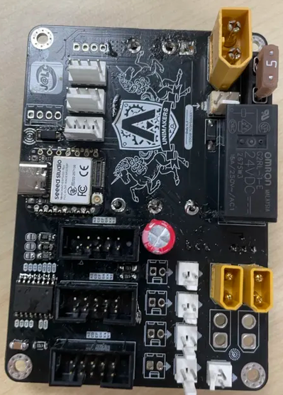
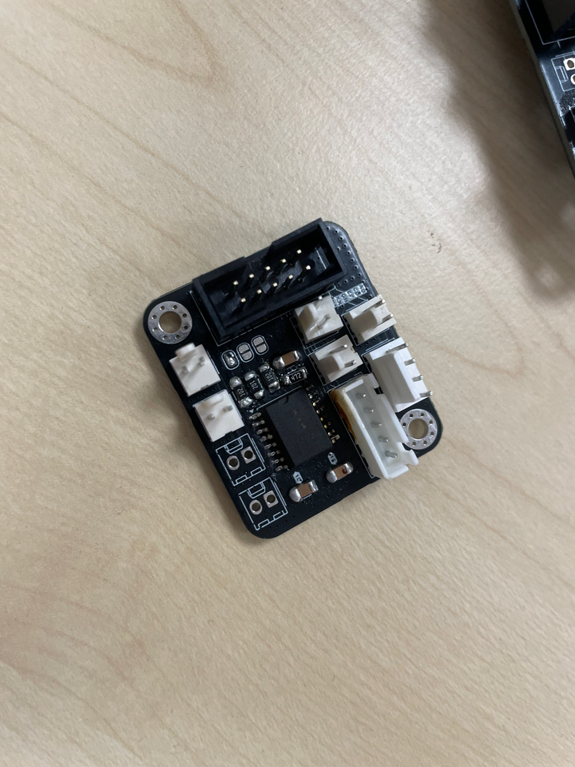
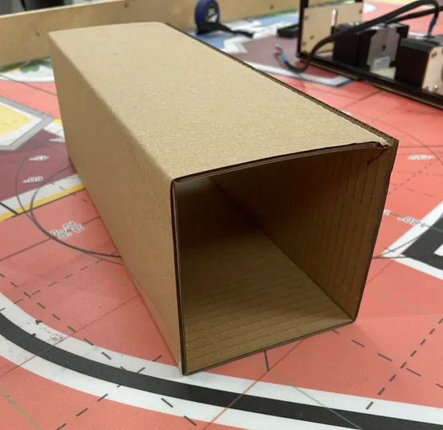
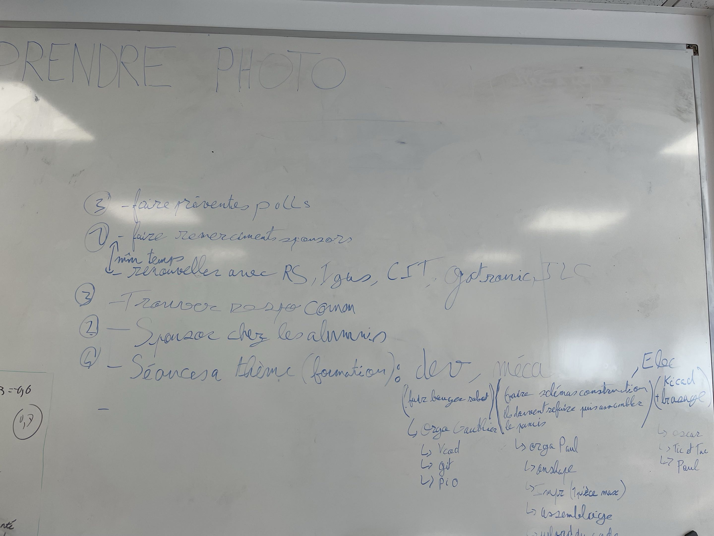

# Bilan de la période — Unimakers Amiens
**Du 21 octobre au 4 novembre 2026 (vacances de la Toussaint incluses) · Eurobot / CDR 2027**

---

## Sommaire

1. Vue d'ensemble
2. Robot principal (Paul, Gauthier)
3. PAMI (Emrick, Martin, Samuel, Romain, Emma)
4. Actionneurs (Brett, Baptiste)
5. Éléments de jeu (Paul)
6. Sponsors (Gauthier, Paul)
7. Administratif et vie de l'association

---

## 1. Vue d'ensemble

| Chantier | Qui | État |
|---|---|---|
| Carte robot principal (JLCPCB) | Paul, Gauthier | **JLC a validé le reel** : commande des cartes imminente |
| Base roulante robot principal | Paul, Gauthier | Cartes de l'an dernier ressoudées pour faire rouler le robot cette semaine |
| PAMI | Emrick | **Le PAMI roule depuis le 04/11** |
| Boîte de dimensions PAMI | Martin, Samuel, Romain | Version « dimensions minimum » faite |
| Actionneur pinces / ventouses | Brett, Baptiste | Premières modélisations, test des pompes |
| Cartons (éléments de jeu) | Paul | 13 cartons faits, côtés collés |
| Sponsors | Gauthier, Paul | **+1 000 € Actemium / VINCI**, CIT renouvelé, bilan annuel envoyé |
| Dossier DMVE | Paul | **Terminé**, reste à l'envoyer |

Journaux de bord de la période :
- **Gauthier :** [21/10](../journal/Gauthier_Henriques/2026_10_21.md) · [22/10](../journal/Gauthier_Henriques/2026_10_22.md) · [23/10](../journal/Gauthier_Henriques/2026_10_23.md) · [02/11](../journal/Gauthier_Henriques/2026_11_02.md) · [03/11](../journal/Gauthier_Henriques/2026_11_03.md) · [04/11](../journal/Gauthier_Henriques/2026_11_04.md)
- **Paul :** [20/10](../journal/Paul_Lapeyronnie/2026-10-20.md) · [21/10](../journal/Paul_Lapeyronnie/2026-10-21.md) · [22/10](../journal/Paul_Lapeyronnie/2026-10-22.md) · [23/10](../journal/Paul_Lapeyronnie/2026-10-23.md) · [25/10](../journal/Paul_Lapeyronnie/2026-10-25.md) · [26/10](../journal/Paul_Lapeyronnie/2026-10-26.md) · [02/11](../journal/Paul_Lapeyronnie/2026-11-02.md) · [03/11](../journal/Paul_Lapeyronnie/2026-11-03.md) · [04/11](../journal/Paul_Lapeyronnie/2026-11-04.md)
- **Emrick :** [19/10](../journal/Emrick_Petit/2026-10-19.md) · [20/10](../journal/Emrick_Petit/2026-10-20.md) · [21/10](../journal/Emrick_Petit/2026-10-21.md) · [23/10](../journal/Emrick_Petit/2026-10-23.md)
- **Brett :** [23/10](../journal/Brett_Legret/2026-10-23.md) · **Baptiste :** [23/10](../journal/Baptiste_Houzelot/2026-10-23.md) · **Martin :** [23/10](../journal/Martin_Milon/2026-10-23.md) · **Samuel :** [23/10](../journal/Samuel_Simao/2026-10-23.md) · **Romain :** [21/10](../journal/Romain_Vantalon/2026-10-21.md) · **Emma :** [23/10](../journal/Emma_Vilain/23-10-2026.md)
- **Réunion :** [compte rendu du 21/10](../reunions/2026-10-21.md)

Les entrées de Paul du 20/10 et d'Emrick du 19 et 20/10 ont été poussées après le récap précédent : elles sont reprises ici.

---

## 2. Robot principal

### Carte électronique
- La carte du robot principal est **terminée** (réunion du 21/10). Paul a envoyé les **fichiers Gerber à JLCPCB** avec le mail de renouvellement du partenariat.
- 04/11 : JLC a répondu, **la commande est prête** ([Paul](../journal/Paul_Lapeyronnie/2026-11-04.md), [Gauthier](../journal/Gauthier_Henriques/2026_11_04.md)).

### Faire rouler le robot
- En attendant la nouvelle carte, **Paul a ressoudé la carte principale de l'an dernier** et **Gauthier a soudé la carte head**. Gauthier peut ainsi avancer sur le code et faire bouger le robot cette semaine.

| Carte principale de l'an dernier (Paul) | Carte head (Gauthier) |
|---|---|
|  |  |

---

## 3. PAMI

### Firmware (Emrick : [21/10](../journal/Emrick_Petit/2026-10-21.md), [23/10](../journal/Emrick_Petit/2026-10-23.md))
- Firmware créé sous **PlatformIO** avec les bibliothèques servos, steppers et télémètre à ultrasons.
- Création d'un **`config.h`** qui nomme toutes les pins de la carte : [documentation des pins](https://github.com/Unimakers/CDR-2027/blob/main/project/firmware/Firmware_PAMI/documentation/Configuration.md).
- **Servomoteur fonctionnel** (va-et-vient de test).
- Avec Adrien Bracq : la cible de téléversement était mauvaise (`esp32-m1-devkit` → **`seeed_xiao_esp32s3`**), et les numéros de pins ont été revérifiés (pins logiques ≠ ports physiques).
- 23/10 : **steppers non fonctionnels**. Le problème semblait venir des pins STEP, et quand la config des steppers était active, même le servo ne marchait plus.
- **04/11 : le PAMI roule !** Le problème des steppers est donc réglé. Ce n'est pas encore dans le journal ni dans la documentation d'Emrick.

### Documentation électronique (dépôt, 25-26/10)
- Emrick a ajouté la page [Carte PAMI](../conception/electronique/carte-PAMI.md) avec le schéma et le PCB KiCad intégrés, ainsi qu'une nomenclature en cours de rédaction.

### Boîte de dimensions réglementaires (Martin, Samuel, Romain : [23/10](../journal/Samuel_Simao/2026-10-23.md))
- Boîte en carton découpée au laser aux **dimensions minimum d'un PAMI** selon le règlement CDR 2027, pour vérifier nos PAMI avant l'homologation.
- Reste à faire : la version **dimensions maximum**.

### Prise en main de l'ESP32-S3 (Emma : [23/10](../journal/Emma_Vilain/23-10-2026.md))
- Tests de câblage sur breadboard autour de l'**ESP32-S3-WROOM-1** et compilation d'un code de test sous PlatformIO.

---

## 4. Actionneurs

### Pinces (Brett : [23/10](../journal/Brett_Legret/2026-10-23.md))
- Principe retenu : reprendre la **courroie de l'an dernier** (2 steppers) pour régler la hauteur, avec une **plaque rotative sur servo** qui porte **3 pinces**.
- Premières pièces modélisées : plateforme et pinces. Pinces en **PLA avec une partie en TPU** pour le grip.
- Prochaine étape : choisir la courroie.

### Ventouses / pompes (Brett, Baptiste : [23/10](../journal/Baptiste_Houzelot/2026-10-23.md))
- Test des pompes pour un actionneur à ventouses : **une prise d'un coup sec fonctionne bien**, une approche lente beaucoup moins.
- Baptiste conçoit le système de **montée/descente** de l'actionneur. Prochains tests : sur le robot mini Otto et sur un support à 3 pompes.

---

## 5. Éléments de jeu

### Cartons (Paul : [20/10](../journal/Paul_Lapeyronnie/2026-10-20.md), [04/11](../journal/Paul_Lapeyronnie/2026-11-04.md))
- **13 cartons** fabriqués aux bonnes dimensions (± 1 mm) : patrons découpés au laser, entailles tous les 107 mm, pliage puis collage.
- 04/11 : côtés collés. Il reste à en finir **3** dans un premier temps, puis **18 autres** pour pouvoir tester deux robots en même temps.

---

## 6. Sponsors

| Sponsor | Où on en est |
|---|---|
| **JLCPCB** | Articles, photos et post Insta envoyés (21/10). JLC a ensuite demandé une **vidéo promo** : réalisée par Gauthier (23/10), retravaillée par Paul et envoyée (02/11). **Reel validé** le 04/11. |
| **Actemium / VINCI** | Proposition de **1 000 €** (22/10). Paul a rédigé une **convention de partenariat**, envoyée avec le RIB (23/10). Ils attendent la liste de ce dont on a besoin. |
| **CIT Dessaint** | Renouvellement **accepté** : 15 % de réduction contre le logo sur nos vêtements (04/11). |
| **RS, Gotronic** | Mail de remerciement et de renouvellement envoyé avec le bilan annuel (03/11). En attente. |
| **Crédit Agricole** | Demande de subvention de 2 000 € envoyée (02/11). Réponse : **la demande est à faire en 2027**. |
| **PCBWay** | Ils proposent un don financier. Mail **en suspens** : on attend d'avoir réglé JLC (qui garde l'exclusivité des PCB) pour leur proposer un autre projet (projet étudiant, Repair-Space). |
| **Aisler** | Contacté, pas de réponse. Les autres sponsors contactés ont refusé. |

### Questions de JLCPCB (04/11)
- Est-ce qu'on met leur logo sur le robot ?
- Est-ce qu'on prévoit des t-shirts ?
- Ils demandent à être mis en contact avec **Adrien Bracq**.

### Documents
- [Bilan annuel UniMakers (PDF)](../assets/documents/Doc_Gauthier_HENRIQUES/Bilan_annuel_Unimakers.pdf), envoyé aux sponsors le 03/11
- [Dossier sponsor en anglais (PDF)](../assets/documents/Doc_Gauthier_HENRIQUES/Sponsorship_Package_UniMakers.pdf)

---

## 7. Administratif et vie de l'association

### Dossier DMVE (Paul)
- Budget : **3 500 € demandés**, 3 000 € attendus (2 500 € obtenus l'an dernier).
- Rapport d'activité et dossier de demande terminés le 04/11 (photos, page de garde, sommaire). **Reste à l'envoyer**, après relecture par Adrien Bracq comme décidé en réunion.

### Tâches du directoire ([02/11](../journal/Gauthier_Henriques/2026_11_02.md))
Paul et Gauthier ont fixé les dernières tâches de gestion de l'association :

| Priorité | Tâche | État au 04/11 |
|---|---|---|
| 1 | Remercier les sponsors et renouveler avec RS, igus, CIT, Gotronic, JLC | Fait pour RS, CIT, Gotronic, JLC. igus sera traité séparément, plus tard |
| 2 | Démarcher des sponsors chez les alumni | — |
| 3 | Préventes des pulls | Présentation à faire |
| 3 | Trouver un ou une responsable communication | Mail envoyé par Paul (03/11) |
| 4 | Séances à thème pour les I1 : dev (Gauthier : VS Code, Git, PlatformIO), méca (Paul : Onshape, impression, assemblage), élec (KiCad, brasage) | À organiser |

### Réunion du 21/10 ([compte rendu](../reunions/2026-10-21.md))
- Promouvoir les projets Unimakers en dehors de la CDR (JPO, SPO) pour attirer des sponsors et des étudiants.
- **Mieux intégrer les I1 :** séances à thème, événements hors travail (impression 3D, soudure), atelier « Programmez votre robot » quand un robot sera fini. Gauthier propose aussi une séance obligatoire par semaine.
- **Ne pas démonter les robots trop tôt**, pour qu'ils servent de modèles les années suivantes.
- Groupe Instagram créé : publier les annonces sur les deux groupes.

### Organisation
- **Planning du Robotlab** (Emrick, [20/10](../journal/Emrick_Petit/2026-10-20.md)) : modèle Excel rempli chaque semaine avec les créneaux où des membres actifs sont présents pour accueillir les étudiants.
- **Excel des équipes** sur Teams (Gauthier, 21/10).

### Développement durable et RSE (Emrick, [21/10](../journal/Emrick_Petit/2026-10-21.md))
Trois pistes sont ressorties de la réunion DD&RS :
- Événements de ressourcerie en tandem avec l'association bien-être et santé (Repair-Space).
- Atelier créatif (impression 3D, découpe laser) sur le thème de la biodiversité.
- **Financement partiel possible** d'un projet de mobilité durable pour les déplacements à la CDR, à condition de montrer un vrai gain en émissions de GES et en coût.

### Repair-Space (Romain, Gauthier : [21/10](../journal/Romain_Vantalon/2026-10-21.md))
- Enceinte Harman Kardon Go+Play qui grésillait : la cause est un pas de vis cassé sur un haut-parleur des basses. Il reste à **imprimer et coller un nouveau pas de vis** pour que l'enceinte soit de nouveau étanche.
