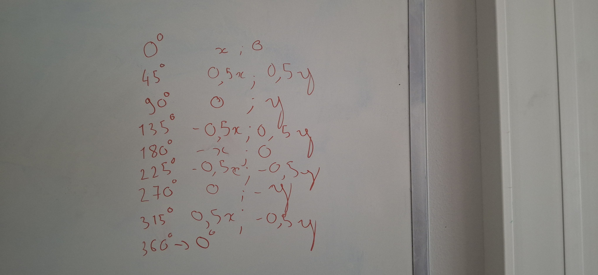
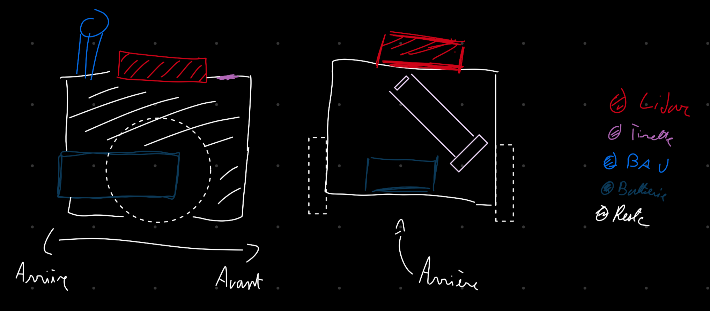
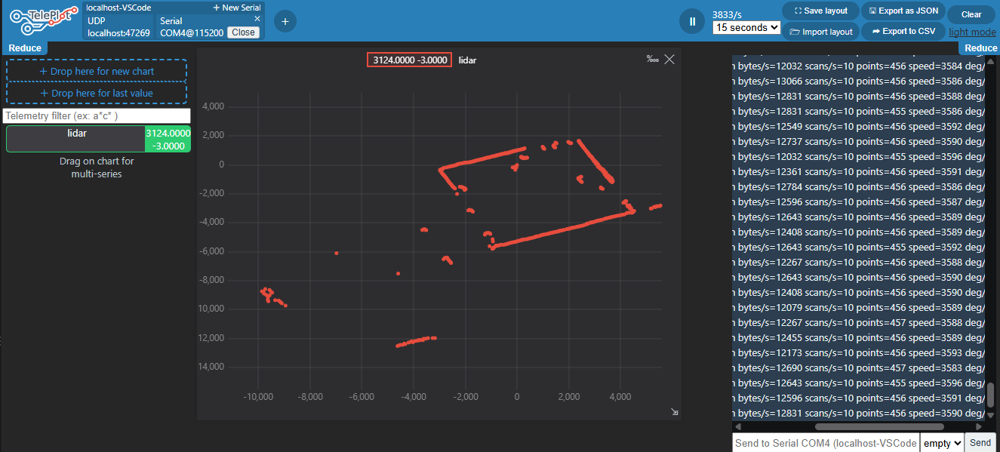
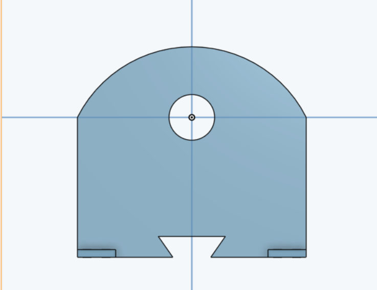

# Bilan de la période — Unimakers Amiens
**Du 18 au 25 novembre 2026 · Eurobot / CDR 2027**

---

## Sommaire

1. Vue d'ensemble
2. PAMI (Emrick, Martin, Romain)
3. Robot principal (Gauthier, Baptiste)
4. Graal (Emma, Emrick)
5. Tests et documentation (Emrick)
6. Gestion de projet (cours du 24/11)
7. Association, partenariats et formation (Paul)
8. Points d'attention

---

## 1. Vue d'ensemble

| Chantier | Qui | État |
|---|---|---|
| Firmware PAMI | Emrick | Réorganisé en bibliothèques, **déplacement absolu commencé** |
| Roues PAMI | Emrick | Nouvelles roues modélisées et imprimées, dimensions recalibrées |
| Nouveau PAMI | Martin, Romain | Première esquisse : **ajout d'un LiDAR** en plus de l'ultrason |
| LiDAR robot principal | Gauthier | **LD06 fonctionnel** (24/11), faux contact probable sur le connecteur |
| Arrêt sur obstacle robot principal | Gauthier | Test 9 écrit, pas encore testé |
| Actionneur ventouses | Baptiste | Base des ventouses modélisée en 3 pièces |
| Graal | Emma, Emrick | Règles lues, pistes d'ascenseur et de pince, **aucune solution choisie** |
| Procédures de test | Emrick | Pages de tests PAMI et robot principal rédigées |
| Subvention Actémium | Paul | **Convention de 1 000 € signée** |
| Commande JLCPCB | Paul | **Bloquée** : le coupon ne s'applique pas |
| Initiations B1/I1 | Paul | Électronique faite le 19/11, mécanique prête pour mercredi prochain |

Journaux de bord de la période :
- **Emrick :** [18/11](../journal/Emrick_Petit/2026-11-18.md) · [19/11](../journal/Emrick_Petit/2026-11-19.md) · [20/11](../journal/Emrick_Petit/2026-11-20.md) · [24/11](../journal/Emrick_Petit/2026-11-24.md)
- **Paul :** [18/11](../journal/Paul_Lapeyronnie/2026-11-18.md) · [19/11](../journal/Paul_Lapeyronnie/2026-11-19.md) · [24/11](../journal/Paul_Lapeyronnie/2026-11-24.md)
- **Gauthier :** [20/11](../journal/Gauthier_Henriques/2026_11_20.md) · [24/11](../journal/Gauthier_Henriques/2026_11_24.md)
- **Emma :** [18/11](../journal/Emma_Vilain/18-11-2026.md) · [20/11](../journal/Emma_Vilain/20-11-2026.md)
- **Baptiste :** [20/11](../journal/Baptiste_Houzelot/2026-11-20.md) · **Martin :** [20/11](../journal/Martin_Milon/2026-11-20.md) · **Romain :** [20/11](../journal/Romain_Vantalon/2026-11-20.md)

Pas de journal sur la période pour Ajaz, Brett et Samuel.

---

## 2. PAMI

### Firmware (Emrick : [18/11](../journal/Emrick_Petit/2026-11-18.md), [20/11](../journal/Emrick_Petit/2026-11-20.md))
- Le firmware est **réorganisé en bibliothèques** : `config`, `converting`, `detection`, `monitoring` et `steppercontrol`. La bibliothèque `detection` est créée mais encore vide.
- **Déplacement absolu** : le déplacement relatif impose un chemin fixé à l'avance et ne permet ni de dévier ni de contourner un obstacle. Emrick a fait un brainstorm théorique sur la mise à jour des coordonnées selon l'orientation, puis écrit les premières fonctions :

| Fonction | Rôle |
|---|---|
| `update_x` / `update_y` | Mettre à jour les coordonnées à partir de l'orientation et de la distance parcourue |
| `updateAngle` | Mettre à jour l'orientation après une rotation sur place |
| `setAngle` | Tourner le PAMI vers une orientation précise |
| `StepToDistance` | Convertir des pas en distance, pour retrouver la distance restante en cas d'interruption |

- 24/11 : le programme du PAMI est **remis en mode démo**.

### Roues (Emrick : [18/11](../journal/Emrick_Petit/2026-11-18.md), [19/11](../journal/Emrick_Petit/2026-11-19.md))
- Les anciennes roues se fixaient de travers : de **nouvelles roues** ont été modélisées et imprimées.
- Les dimensions (diamètre des roues, entraxe) ont été remesurées, et les rotations affinées par des tests de rotation répétés.

### Nouveau PAMI (Martin, Romain : [20/11](../journal/Martin_Milon/2026-11-20.md))
- Décision : ajouter un **LiDAR** au PAMI, en plus du capteur à ultrasons. Les boîtes couchées sont plus basses que le champ du LiDAR, l'ultrason reste donc nécessaire.
- Le LiDAR serait fixé sur un pilier dédié, avec le BAU.
- **Problèmes à régler :**
  - le canon de l'actionneur pourrait masquer le LiDAR (pistes : raccourcir le canon ou prévoir une zone morte) ;
  - il faut vérifier que le BAU reste homologable (facilement accessible) s'il est placé au niveau du LiDAR.
- Reste à faire : la carte électronique du PAMI.

---

## 3. Robot principal

### LiDAR et tirette (Gauthier : [20/11](../journal/Gauthier_Henriques/2026_11_20.md), [24/11](../journal/Gauthier_Henriques/2026_11_24.md))
- **LiDAR LD06** et **tirette** branchés sur la carte head.
- **Test 8** : quand on tire la tirette, les scans du LiDAR s'affichent dans Teleplot. Le buffer de réception a été agrandi pour supprimer les erreurs CRC.
- **24/11 : le LiDAR fonctionne.** Il s'est mis à scanner après avoir été débranché puis rebranché : le connecteur a probablement un **faux contact**, à vérifier.
- **Test 9 écrit** (pas encore testé) : le robot roule en carré et s'arrête devant un obstacle détecté par le LiDAR sur 360°, puis reprend son trajet quand la voie est libre.

### Actionneur ventouses (Baptiste : [20/11](../journal/Baptiste_Houzelot/2026-11-20.md))
- La base des ventouses est modélisée en **3 pièces**, reliées par des vis et des clips en puzzle.
- Reste à faire : la relier au reste de l'actionneur, concevoir la pièce entre pompes et ventouses, réduire la largeur des pièces et faire l'assemblage dans Onshape.

---

## 4. Graal (Emma : [18/11](../journal/Emma_Vilain/18-11-2026.md), [20/11](../journal/Emma_Vilain/20-11-2026.md) · Emrick : [20/11](../journal/Emrick_Petit/2026-11-20.md))

### Ce que disent les règles
- Le Graal est fabriqué par l'équipe et posé dans la salle du trône pendant la préparation. Il doit être plus grand qu'un cube de 60 mm.
- Pendant le match, le robot doit le poser **le plus haut possible** sur un support (pierre, construction ou robot).
- **Points :** 5 pts si le Graal est dans le château, plus 5 pts par niveau, jusqu'au niveau 4 (toit du robot, à plus de 30 cm).
- Un Graal encore tenu par un actionneur en fin de match ne compte pas.

### Pistes étudiées

| Système | Avantage | Inconvénient |
|---|---|---|
| Ascenseur à courroie | Très maniable | Nécessite au moins un stepper |
| Ascenseur à crémaillère | Facile à mettre en place | Gear ratio élevé, qui peut abîmer les servos ; tend à dépasser en hauteur |
| Ascenseur à poids | Très simple | Alourdit le robot, une seule utilisation par match |
| Pince | Légère, peu encombrante | Où la fixer ? Prise du Graal à valider |

**Aucune solution n'est encore choisie.**

---

## 5. Tests et documentation (Emrick : [19/11](../journal/Emrick_Petit/2026-11-19.md))
- Les procédures de test sont rédigées et séparées en deux pages : [tests PAMI](../tests/tests_PAMI.md) et [tests robot principal](../tests/tests_robot_principal.md).
- Elles serviront à valider le déplacement absolu et la précision des PAMI.

{: .note}
> Il n'y a **toujours pas de cahier des charges voté**. Il faut le voter rapidement pour l'intégrer à la documentation.

---

## 6. Gestion de projet (cours du 24/11)

### Scénario de match des PAMI ([Emrick](../journal/Emrick_Petit/2026-11-24.md))
1. **Préparation :** positionner les PAMI selon leur numéro, les allumer et les initialiser. Chaque PAMI confirme qu'il fonctionne (signal visuel ou sonore), puis on met la tirette.
2. **Attente (0 à 85 s) :** les PAMI attendent la 85e seconde.
3. **Actions (après 85 s) :** déploiement selon la stratégie, avec évitement des obstacles.
4. **Fin du match (100 s) :** arrêt immédiat.

### Choix techniques du robot principal : diagramme FAST ([Paul](../journal/Paul_Lapeyronnie/2026-11-24.md))
- Fonction principale : **jouer un match**, découpée en homologuer, démarrer, se déplacer, jouer la mission et terminer.
- Solutions fixées pour l'instant : la **tirette** pour activer le robot, et le principe **détection puis réaction** (évitement, arrêt) pour ne pas toucher l'adversaire.
- La plupart des autres solutions sont encore **à définir** : dimensions restreintes ou étendues, stratégie (IA, automate, réactionnaire), interaction avec les cartons…

---

## 7. Association, partenariats et formation (Paul)

### Subvention Actémium Amiens ([24/11](../journal/Paul_Lapeyronnie/2026-11-24.md))
- Actémium Amiens verse **1 000 €** pour la Coupe de France de robotique.
- Documents envoyés : Cerfa, attestation de non-conflit d'intérêts et convention. **La convention est signée.**

### JLCPCB ([18/11](../journal/Paul_Lapeyronnie/2026-11-18.md))
- JLCPCB a crédité un **coupon** sur le compte de l'association (75 € selon le journal, 75 $ selon le mail cité). L'accès au compte est confirmé.
- **Le coupon ne s'applique pas au paiement** : la commande des cartes est bloquée. Il faut relancer JLCPCB.
- Les stickers JLCPCB sont en rupture : le logo sera **gravé au laser sur le robot**.

### Initiations B1/I1 ([18/11](../journal/Paul_Lapeyronnie/2026-11-18.md), [19/11](../journal/Paul_Lapeyronnie/2026-11-19.md), [24/11](../journal/Paul_Lapeyronnie/2026-11-24.md))
- **Électronique (19/11) :** séance menée jusqu'au bout (soudure, composants utilisés à Unimakers, schéma et PCB sous KiCad).
- **Mécanique (mercredi prochain) :** PAMI d'entraînement finalisé sur Onshape, et **3 PAMI imprimés** (3 × 8 pièces en PLA, environ 2 h 30 par PAMI) pour environ 6 I1.
- Ensuite : l'initiation au code.

---

## 8. Points d'attention

| Point | Qui | Action |
|---|---|---|
| Cahier des charges non voté | Toute l'équipe | Le voter rapidement |
| Commande JLCPCB bloquée par le coupon | Paul | Relancer JLCPCB |
| Faux contact probable sur le connecteur du LiDAR | Gauthier | Contrôler ou remplacer le connecteur |
| Test 9 (arrêt sur obstacle) non testé | Gauthier | Le lancer sur le robot |
| Déplacement absolu PAMI non validé | Emrick | Terminer les fonctions et passer les tests PAMI |
| BAU et LiDAR du nouveau PAMI | Martin, Romain | Vérifier l'homologation du BAU |
| Graal sans solution choisie | Emma, Emrick | Choisir une piste et la prototyper |
