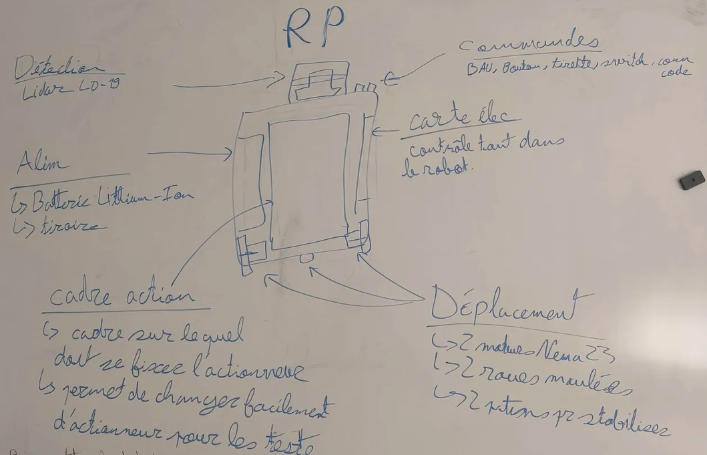

# Bilan de la semaine — Unimakers Amiens
**Semaine du 7 au 13 octobre 2026 · Eurobot / CDR 2027**
 
---
 
## Sommaire
 
1. Vue d'ensemble de la semaine
2. PAMI : stratégie, cahier des charges, documentation (Ajazz, Emrick, Romain)
3. Actionneur du robot principal (Baptiste, Brett)
4. Logiciel et firmware (Emma, Gauthier)
5. Carte électronique (Paul)
6. Éléments de jeu (Martin)
7. Vie de l'association
---
 
## 1. Vue d'ensemble
 
| Chantier | Qui | État |
|---|---|---|
| Stratégie et tests PAMI | Ajazz, Emrick, Romain | Stratégie définie, cahier des charges en ébauche |
| Actionneur robot principal | Baptiste, Brett | Concept choisi, V1 cadrée, modélisation à venir |
| Architecture logicielle et batterie de tests | Emma | Plan en 6 étapes, tests prêts à être remplis |
| Firmware robot principal | Gauthier | Config modulable, classes actionneurs, I2C validée |
| Carte électronique | Paul | Carte refaite, routage propre, vérification en attente |
| Éléments de jeu | Martin | Cartons de carrière préparés (entrée du 25/09) |
| Organisation / atelier | Emrick | Doc PAMI en ligne, Gridfinity, portes ouvertes |
 
---
 
## 2. PAMI
 
### Ajazz
- Définition des **objectifs et modalités de test** des PAMI
- Croquis de l'**apparence** des PAMI
- Stratégie : **PAMI gardes** (défendent les douves) + **PAMI chevaliers** (attaquent le château)
- Déplacement **en métrique** d'abord (distance / angle), puis en coordonnées (absolues / relatives)
- Rappel : **laisser une zone libre pour l'autocollant**
### Emrick (brainstorm du 09/10 avec les I2 de l'équipe PAMI)
**Deux types de PAMI**
 
| Type | Rôle | Particularités |
|---|---|---|
| **Gardes** | Se placent dans chacune des 3 douves, bloquent l'accès et « attaquent » les PAMI adverses | Position fixe, système de tir axé sur la **portée** |
| **Chevaliers** | Chacun a une douve adverse à rejoindre en 15 s | Pathfinding et évitement plus poussés, tir **en cloche** (murailles devant) |
 
- Logique « gagnant-gagnant » : soit on marque des points d'attaque, soit l'adversaire ne marque pas de points douves.
- Catapulte / baliste prévue sur **tous** les PAMI, avec un système adapté au type.
**Ébauche de cahier des charges**
 
| Critère | Attendu |
|---|---|
| Ligne droite | déviation < 1° |
| Rotation | déviation < 1° |
| Actionneur d'attaque | pas d'impact, trace ou déchirure sur la boîte, incapable de déplacer un PAMI |
| Boulets | 70 % dans la cour adverse |
 
### Romain
- Compte rendu du même brainstorm (présidé par Emrick, avec Ajazz et Samuel Simao)
- Tests prévus : ligne droite et rotation à **0° d'erreur**, actionneur de contact d'abord sur **cartons**, puis sur PAMI une fois sans impact sur la boîte
- Unités métriques, coordonnées relatives puis absolues, zone d'autocollant à garder

---
 
## 3. Actionneur du robot principal
 
### Baptiste
- Réalisation du **schéma de l'actionneur**
- Matériel : 1 servomoteur, 2 pompes, 1 moteur pas à pas, 1 courroie
- Idée : **prendre 3 cartons d'un coup** avec les pompes, puis tourner le support des pompes selon la construction à réaliser
### Brett, séance du 09/10 (conception)
- Étude du **simulateur 3D** de la table et du règlement Eurobot 2027 (figure 6 : plan du château)
- Trois concepts :
  - **A** : préhension centrale qui se resserre, monte, descend, avec pivot éventuel
  - **B** : bras latéraux de chaque côté, pour faciliter les rotations
  - **C** (retenu) : **rail fixe + courroie**, bloc avec servo 360° et pinces indépendantes ; les pinces serrent, la courroie gère la hauteur
- Nomenclature de l'époque : **6 moteurs** (2 pas à pas pour l'élévation, 4 servos pour rotation et pinces)
### Brett, périmètre V1 (entrée du jour)
- **Objectif** : construire les murs (3 pierres à plat) et poser les 2 pierres verticales de la porte. La 3e pierre de la porte est hors scope.
- **Architecture** : 1 seul axe vertical (NEMA17 + driver TMC2209), pas de bras articulé, le châssis gère le XY
- **Positions codées en dur** : niveaux de mur ~110 / 220 / 330 mm, porte ~160 mm
- **Pince** : serrage latéral sur les grandes faces (320×110 mm), servo FS5115M + double crémaillère (ouverture symétrique sans code de synchronisation), guidage nécessaire
- **Pose** : descente, contact, ouverture latérale, remontée dégagée
- **Risque identifié** : pierre de porte haute (320 mm) sur base étroite (110×110 mm), qui peut basculer. Piste : guide passif au sol ou guidage vertical sans jeu.
- **Règlement** : hauteurs ≤ 330 mm, sous la limite de 350 mm. Gabarit robot largement suffisant.

---
 
## 4. Logiciel et firmware
 
### Emma (entrée du 09/10)
- Code **multi-fichier**, 1 fichier par actionneur, géré par un système booléen, pour rester modulaire
- **Plan en 6 étapes** : mobilité → LiDAR → tirettes → actionneurs → switchs → écran (si le temps le permet)
- Attention : **aucun moyen de tester pour l'instant**
- **Batterie de tests** : 40 essais par valeur, table de 3 m × 2 m
  - Rouler droit : 10 cm, 20 cm, 50 cm, 1 m et plus
  - Tourner : 10°, 50°, 100°, 180°, 360°
  - Serpentin, puis simulation de match
  - Relatif puis absolu
- Tableau de relevé prêt (marge d'erreur par essai), encore vide
### Gauthier
**07/10**
- Rappel : software (haut niveau, sur OS) vs firmware (bas niveau, sur microcontrôleur)
- Mise en place de `config.h`, **configuration modulable** pour que tous les actionneurs soient transférables
- Contenu : 6 drivers TMC2209, alimentation servos, I2C, écran TFT SPI, entrées (tirette, bouton, 3 switchs), LiDAR LD06
- Liste des I1 arrivés mercredi soir, pense-bête : Kalman, sensor fusion
**09/10**
- Notes actionneurs : 4 steppers, 24 servos/pompes sur 3 lignes de 8, un seul code actionneur pour tous les types
- Notes SPI (SCK, SDI, SDO, CS), flash/RAM/PSRAM, choix d'un module ESP32-S3 plutôt que le composant seul
- À faire : passer de 3 PCF8574 à **2 PCA9685**
**12/10**
- Passage **PCF8574 → PCA9685** (2 × 16 canaux = 32 connecteurs), `~OE` partagée, `static_assert` sur les adresses I2C
- Ajout de la **classe actionneur** (stepper, servo, pompe), du **timer de match** (`MATCH_DURATION` en ms) et de checks de config steppers
- Scan I2C et README du firmware
- **Test réussi** : I2C fonctionnelle, adresses des PCA reconnues
- À tester : 6 steppers sur breadboard, 2 PCA, un servo, une pompe
- Nouveaux I1 : Jean Mouly, Enzo Maaz

---
 
## 5. Carte électronique
 
### Paul
- **Refonte complète** de la carte, avec correction de ses erreurs précédentes
- Composants alignés sur la grille, zones plutôt que pistes en zigzag, majorité sur la couche rouge
- Pins réordonnées pour **supprimer les croisements** ; écran, SDA/SCL, tirette, bouton et Enable reliés
- Pas encore validée avec Alban
- Points peu satisfaisants : contour du Enable, détour de SDA/SCL
- **Erreurs corrigées** :
  - PCF remplacé par PCA (la latence du PCF fait saccader les servos)
  - Pins RX/TX du LiDAR déplacées (les pins par défaut posaient problème) ; un switch retiré pour ajouter la pin OE
- **Apprentissages** :
  - Sur le devkit, les pins 27 à 35 servent à la PSRAM / flash quad SPI mais ne sont pas reliées aux broches externes
  - Un module ESP contient la puce, des composants de base, une antenne et un blindage
  - Vias en 0,7 / 0,4
- Dossier sponsor : titre ajouté, contenu à venir

---
 
## 6. Éléments de jeu
 
### Martin (entrée du 25/09)
- Préparation des **cartons de la carrière de pierre**
- Ajustement des mesures (mieux, reste à améliorer) : le côté de fermeture a **5 mm de jeu**

---
 
## 7. Vie de l'association
 
- Réunion (07/10) sur l'organisation des équipes, l'**intégration progressive des 1res années** et les **sponsors**
- **Documentation PAMI v1.0** en ligne pour les premières années (détail des composants encore manquant)
- **Gridfinity** : bases imprimées pour la servante, prochaine étape = slots pour les outils
- **Robotlab** rangé pour la **soirée portes ouvertes**
- **Nouveaux I1** : Jean Mouly, Enzo Maaz, plus la liste des arrivants du mercredi soir

---

## résumer des fonctionalité  du robot
